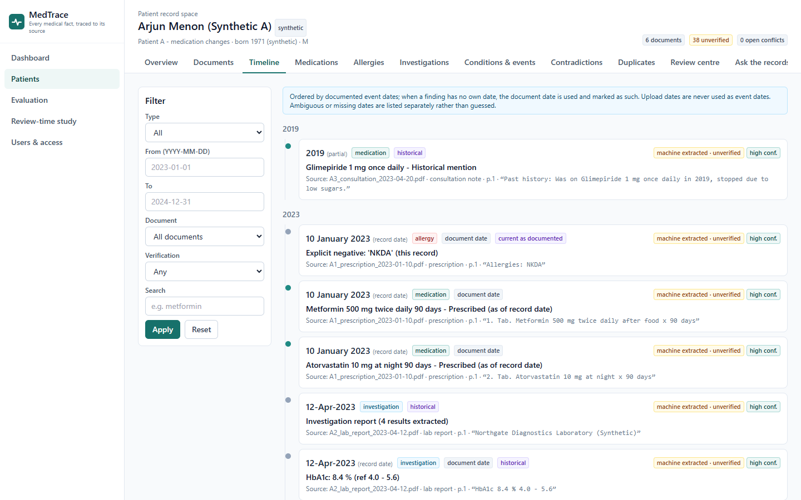
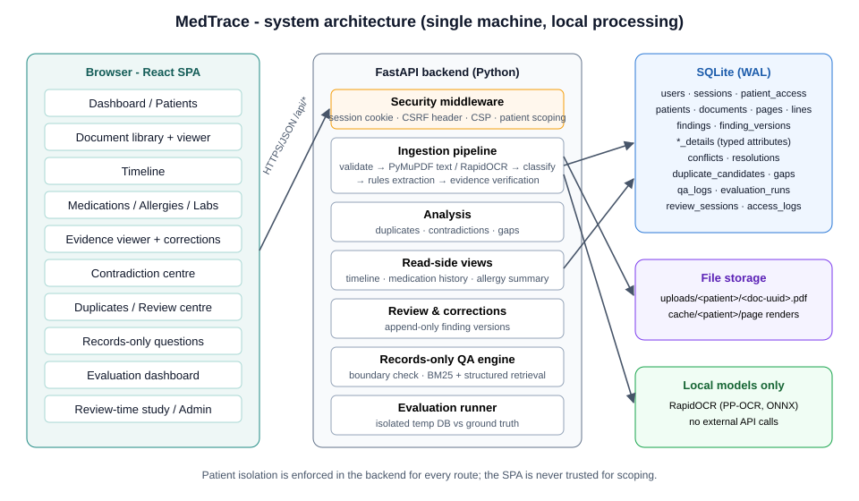
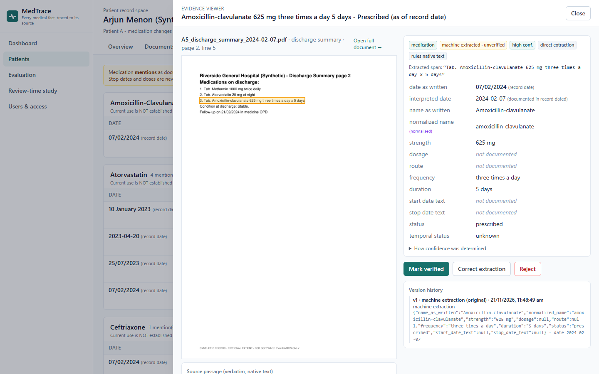
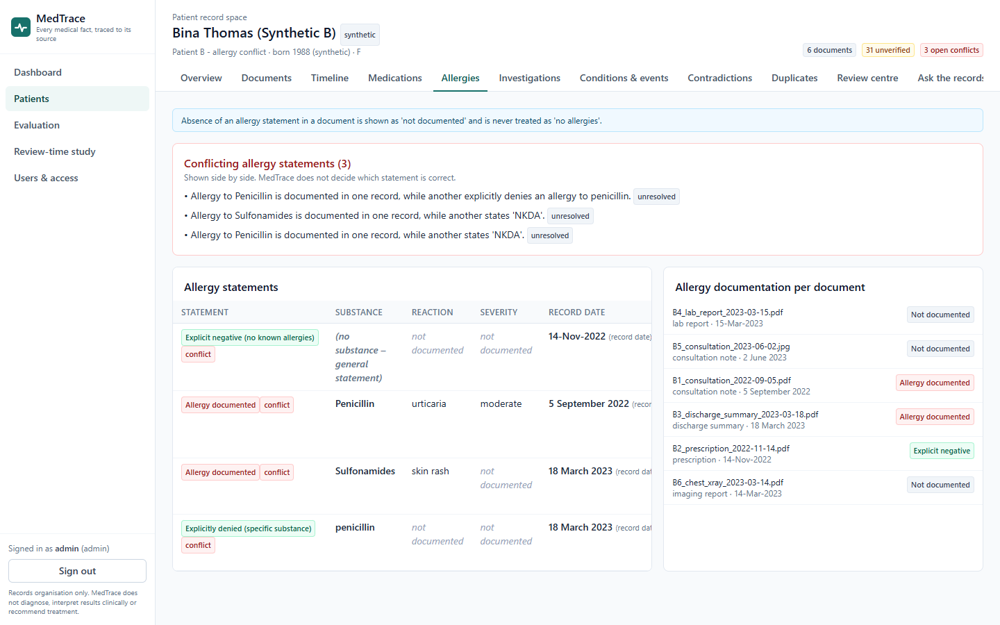
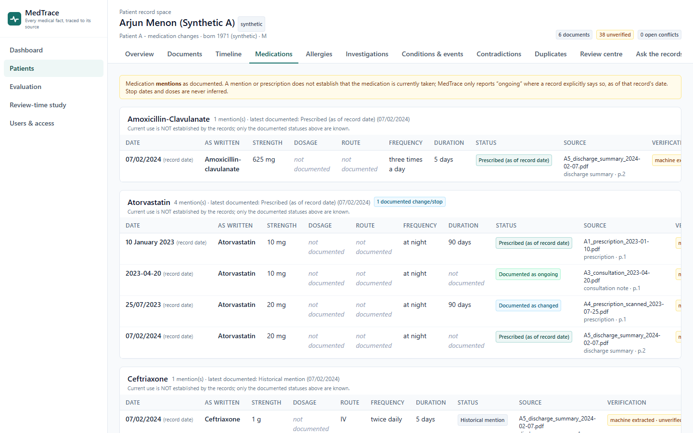
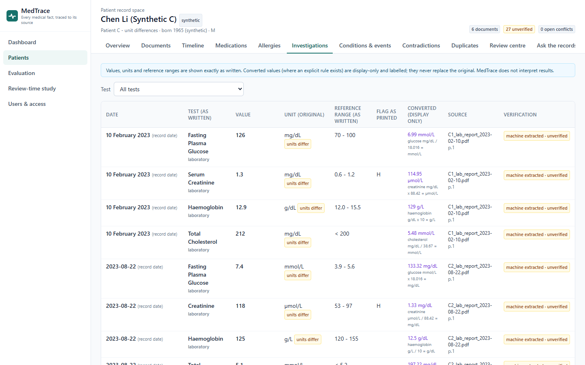
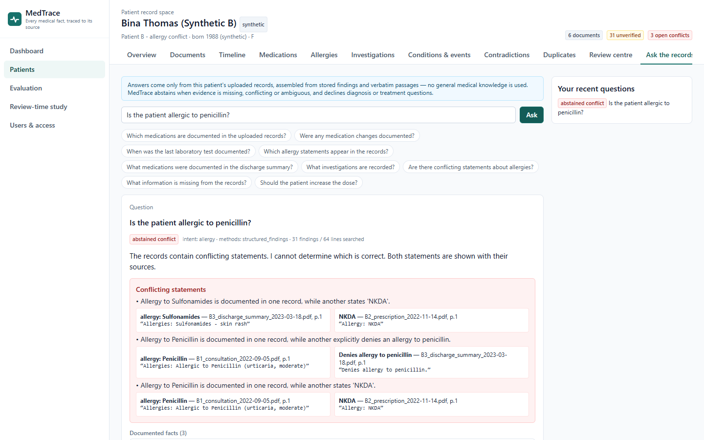
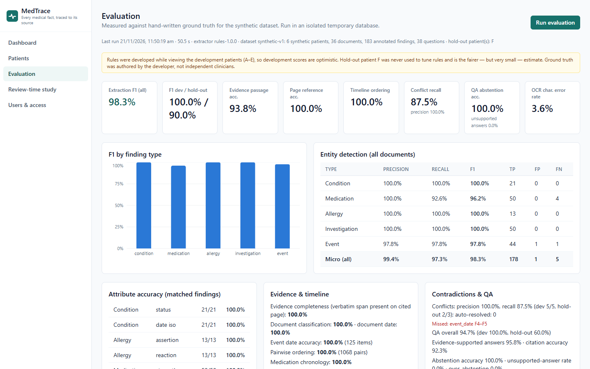

# MedTrace — One Patient, Many Records

**Every medical fact, traced to its source.**

MedTrace turns a folder of heterogeneous medical documents (prescriptions, lab reports, discharge summaries, consultation notes, imaging reports — native PDFs, scanned PDFs and photos) into a **chronological, evidence-linked medical history**. Every extracted fact points to the exact document, page, line and verbatim passage it came from; contradictions are surfaced rather than silently resolved; missing information stays visible; and a records-only question interface answers only when the uploaded records support the answer.

> **MedTrace is a records organisation and evidence-retrieval system.** It is **not** a diagnostic system, a treatment or medication recommender, or clinical decision support. It never diagnoses, interprets results clinically or recommends changes. All data in this repository is **synthetic**.



## Contents
- [Problem](#problem) · [Features](#features) · [Architecture](#architecture) · [Tech stack](#technology-stack)
- [Setup](#installation) · [Commands](#commands) · [Dataset](#synthetic-dataset) · [Using the app](#using-the-app)
- [Evaluation results](#evaluation-measured) · [Screenshots](#screenshots) · [Limitations](#limitations) · [Documentation](#documentation)

## Problem
A patient's history is scattered across documents that repeat each other, contradict each other, use different units and date formats, describe medication changes, mix historical with current information, and contain OCR errors. A folder of PDFs is not a medical history, and naive AI summaries lose dates, merge medication statuses, hide contradictions, drop dosages and treat missing information as a negative finding. MedTrace addresses the **data organisation, extraction, chronology, provenance and verification** problem — without acting as a doctor.

## Features
| Area | What is implemented |
|---|---|
| Ingestion | PDF (native + scanned), PNG, JPG/JPEG; extension + magic-byte validation, size/page limits, rejection of PDFs with JavaScript/launch actions/embedded files, decompression-bomb protection, UUID storage names, SHA-256 integrity hash |
| Text & OCR | PyMuPDF text layer with per-line bounding boxes; **local** RapidOCR (PP-OCR, ONNX Runtime) only when a page has no usable text layer; native / OCR / human-corrected text distinguished; OCR confidence recorded |
| Classification | Rules-based classifier (lab report, prescription, discharge summary, consultation note, imaging report) with OCR-robust cues; reviewer can override (original kept) |
| Extraction | Conditions (with *suspected / possible / ruled out / history of / known case* preserved), medications (name as written + normalised, strength, dosage, route, frequency, duration, start/stop, 8 documented statuses), allergies (documented / explicitly denied / general negative / status not recorded), investigations (value, **original unit**, reference range as written, printed flag, display-only conversion), events (admission, discharge, surgery, procedure, consultation, investigation, follow-up) |
| Dates | Original text always kept; DD/MM vs MM/DD **never guessed** — ambiguous dates keep both candidates unless the document declares its convention; partial dates keep precision; two-digit years flagged |
| Provenance | Each finding: document, page, line range, bounding box, verbatim passage, extracted span, method, provenance type, confidence + reasons, verification status, version history |
| Timeline | Chronological history from documented event dates (never upload dates); document-date fallback is labelled; undated/ambiguous entries listed separately; filters by type, date range, document, verification, text |
| Medication history | Mentions per medication in date order, documented changes/stops, between-record strength differences; never implies current use |
| Duplicates | Exact (hash), near-duplicate (OCR-tolerant similarity + compatible dates), similar-but-distinct, duplicate/related findings; review interface; nothing merged |
| Contradictions | Same-day dose and status conflicts, allergy vs negative statements, event-date conflicts, same-day lab value conflicts; human review with mandatory explanation and resolution history; never auto-resolved |
| Gaps | Missing dose/frequency/date/reaction/reference range/document date, uncertain status, unit differences, OCR quality, instruction-like text — always phrased as statements about documentation |
| Corrections | Verify / correct / reject findings, correct page text and document type; machine version 1 and verbatim evidence immutable; reviewer, timestamp and reason recorded; timeline updates immediately |
| Records-only QA | Structured retrieval + BM25 keyword search over the selected patient's records; cited answers with page and passage; abstains on missing/conflicting/ambiguous evidence; declines diagnosis, interpretation, treatment advice and speculation |
| Security | Session auth (scrypt, HttpOnly SameSite=Strict cookie, hashed server-side tokens, lockout), CSRF header, roles (admin/reviewer/viewer), backend patient scoping (404 for others' records), CSP + security headers, identifier-only audit log, prompt-injection-inert design |
| Evaluation | Ground-truth dataset, precision/recall/F1 by type and field, evidence, timeline, duplicates, contradictions, QA abstention, OCR CER, latency, labelled review-time estimate, human timing tool |

## Architecture


Pipeline: **Upload → Validation → Patient association → Classification → OCR/Text extraction → Structured extraction → Evidence verification → Duplicate detection → Conflict detection → Timeline integration.** Details: [docs/ARCHITECTURE.md](docs/ARCHITECTURE.md).

## Technology stack
- **Frontend:** React 18, Vite 5, TypeScript, Tailwind CSS 3, Recharts, React Router
- **Backend:** Python (tested on 3.14; 3.10+ expected to work but untested), FastAPI, Pydantic, Uvicorn
- **Database:** SQLite (WAL), stdlib `sqlite3`
- **Documents:** PyMuPDF, Pillow, RapidOCR + ONNX Runtime (local OCR; Tesseract is not required)
- **Testing:** Pytest, FastAPI TestClient (HTTPX), Playwright (screenshots only)
- **No paid API keys and no external services are required.**

## Installation
Prerequisites: Python 3.14 (tested; 3.10+ likely), Node.js ≥ 18 (tested on 24), ~1 GB disk (OCR models are bundled with the `rapidocr` wheel).

```bash
git clone <this repository> && cd MedTrace
python -m venv .venv
# Windows: .venv\Scripts\activate     macOS/Linux: source .venv/bin/activate
pip install -r backend/requirements-dev.txt
cd frontend && npm install && npm run build && cd ..
cp .env.example .env      # then set MEDTRACE_ADMIN_PASSWORD (and optionally MEDTRACE_DEMO_REVIEWER_PASSWORD)
```

## Commands
| Purpose | Command (run from `backend/`) |
|---|---|
| Generate the synthetic dataset (already committed) | `python ../dataset/generate_dataset.py` |
| Load the synthetic dataset into the local DB | `python -m medtrace.seed --reset` |
| Start the app (API + built SPA on one origin) | `python -m uvicorn medtrace.main:app --port 8000` → http://127.0.0.1:8000 |
| Frontend dev server with hot reload (proxies `/api`) | `cd ../frontend && npm run dev` → http://localhost:5173 |
| Run the test suite (77 tests) | `python -m pytest -q` |
| Run the evaluation and write the report | `python -m medtrace.evaluation.runner` → `docs/evaluation/EVALUATION_REPORT.md` |
| Regenerate screenshots (server running) | `python ../docs/tools/capture_screenshots.py` |
| Build the PDFs (written to `docs/pdf/`, gitignored) | `python ../docs/tools/build_pdfs.py` |
| API reference (interactive) | http://127.0.0.1:8000/docs |

Sign in with `MEDTRACE_ADMIN_USERNAME` / `MEDTRACE_ADMIN_PASSWORD` from `.env`. If no admin password is configured, a random one is generated and printed **once** to the console on first start. If `MEDTRACE_DEMO_REVIEWER_PASSWORD` is set, the seed creates user `reviewer` with access to patients A–C only (demonstrates isolation).

## Synthetic dataset
36 documents for 6 fictional patients (`dataset/documents/`, ground truth in `dataset/ground_truth.json`), rendered as 29 native PDFs, 3 scanned (image-only) PDFs, 3 PNG and 1 JPG. Types: 12 lab reports, 10 consultation notes, 7 prescriptions, 4 discharge summaries, 3 imaging reports; 183 hand-annotated findings; 38 records-only questions.

| Patient | Scenario |
|---|---|
| A — Arjun Menon (Synthetic) | Medication changes: initial prescription, dose increase, scanned prescription with new drug, stop during admission, historical drug |
| B — Bina Thomas (Synthetic) | Allergy conflict: penicillin allergy vs NKDA vs "denies allergy to penicillin"; a note with no allergy statement |
| C — Chen Li (Synthetic) | Unit differences: mg/dL vs mmol/L vs µmol/L, g/dL vs g/L, % vs mmol/mol, different reference ranges |
| D — Diego Fernandes (Synthetic) | Duplicates: exact copy, amended re-issue (one value changed), scanned copy of a note, similar-but-distinct follow-up report |
| E — Esha Rao (Synthetic) | Missing information: undated note, ambiguous dates, missing doses, uncertain statuses, an embedded prompt-injection line |
| F — Farah Siddiqui (Synthetic) | **Hold-out** set — never used to tune rules |

## Using the app
1. **Patients** → choose a patient (or create a synthetic one) → **Documents** → drag & drop PDFs/images. Processing status, OCR status and findings counts update automatically.
2. **Timeline** — chronological, filterable; click any entry to open the **evidence viewer** (page image with the source line highlighted, verbatim context, extracted fields, confidence reasons, version history, verify/correct/reject).
3. **Medications**, **Allergies**, **Investigations**, **Conditions & events** — structured views that show "not documented" instead of guessing.
4. **Contradictions** — evidence from each source side by side; record a review status with an explanation.
5. **Duplicates** — confirm or reject candidates; originals are always kept.
6. **Review centre** — low-confidence and ambiguous-date queues, all unverified findings, history of human reviews.
7. **Ask the records** — factual questions with cited answers or honest abstention.
8. **Evaluation** — measured metrics; admins can re-run the evaluation.

## Evaluation (measured)
Measured by `python -m medtrace.evaluation.runner` on 2026-11-21 (extractor `rules-1.0.0`). Full report: [docs/evaluation/EVALUATION_REPORT.md](docs/evaluation/EVALUATION_REPORT.md).

| Metric | All docs | Development (A–E, 31 docs) | Hold-out (F, 5 docs) |
|---|---|---|---|
| Extraction precision | 0.994 | 1.000 | 0.964 |
| Extraction recall | 0.973 | 1.000 | 0.844 |
| Extraction F1 | **0.983** | 1.000 | **0.900** |

- Evidence: page reference accuracy 1.00; evidence-passage accuracy 0.938; evidence completeness 1.00 (every finding's verbatim span exists on its cited page)
- Timeline: event-date accuracy 1.00 (125 items); pairwise ordering 1.00 (1,068 pairs); no fabricated dates for 40/40 undated/ambiguous items
- Duplicates: precision 1.00, recall 1.00, false-positive rate 0.00 (87 non-duplicate pairs)
- Contradictions: precision 1.00, recall 0.875 (missed the hold-out surgery-date conflict); auto-resolved: 0
- Records-only QA (38 questions): overall 0.947 (dev 1.00, hold-out 0.60); abstention accuracy 1.00; unsupported-answer rate 0.00; cross-patient citations 0
- OCR: mean character error rate 3.6 % on 7 OCR documents; median processing 138 ms (native PDF) vs 5.8 s (OCR) on the development laptop
- Review time: **automated reading-load estimate only** (36 % fewer estimated seconds) — **no human study has been performed**; the app includes a timing tool for one

**Read these numbers honestly.** Rules were developed while looking at the development patients, so development scores are optimistic (they were 0.98 F1 / 0.84 QA before tuning — see [BASELINE_BEFORE_TUNING.md](docs/evaluation/BASELINE_BEFORE_TUNING.md)). The hold-out patient is the fairer estimate, and it is small. Ground truth was written by the developer, not independent clinical annotators.

## Screenshots
| | |
|---|---|
|  Evidence viewer |  Allergy statements & conflicts |
|  Medication history |  Original units preserved |
|  Abstaining on conflicting records |  Evaluation dashboard |

## Limitations
- Rules + small lexicons recognise only phrasing they encode (e.g. the hold-out drug *propranolol* is not in the lexicon and was missed). No ML/LLM extraction is used.
- English only; layouts in the dataset are limited; handwriting is not supported; OCR quality depends on scan quality.
- Contradiction rules cover specific categories; absence of a detected conflict is not proof of consistency.
- Local single-machine MVP: no TLS termination, no encryption at rest, background processing in-process, SQLite.
- **No regulatory compliance (HIPAA, GDPR, etc.) is claimed or has been assessed.** Use synthetic data only.

## Documentation
[Technical documentation](docs/TECHNICAL_DOCUMENTATION.md) · [Architecture](docs/ARCHITECTURE.md) · [Data model](docs/DATA_MODEL.md) · [Extraction & provenance](docs/EXTRACTION_AND_PROVENANCE.md) · [Timeline & contradictions](docs/TIMELINE_AND_CONTRADICTIONS.md) · [Records QA](docs/RECORDS_QA.md) · [Security & privacy](docs/SECURITY_AND_PRIVACY.md) · [API](docs/API_DOCUMENTATION.md) · [Testing & evaluation](docs/TESTING_AND_EVALUATION.md) · [Contributing](CONTRIBUTING.md) · PDFs (technical documentation, project report): generated locally into `docs/pdf/` with `python docs/tools/build_pdfs.py` (not committed)
