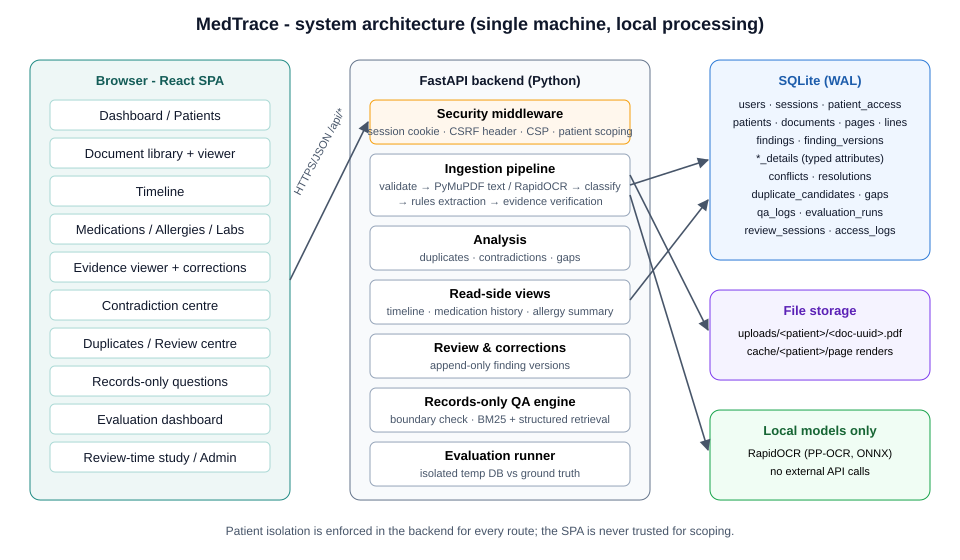
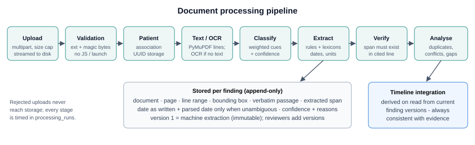
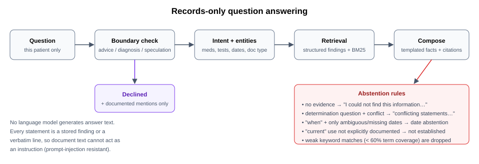

# MedTrace Architecture

MedTrace is a single-machine application: a React single-page app served by a FastAPI backend from the same origin, a SQLite database, a file store for uploaded originals, and a local OCR model. No component calls an external service.

## Frontend (`frontend/`)
- React 18 + TypeScript, built by Vite; Tailwind CSS for styling; Recharts for the evaluation and dashboard charts.
- `src/api.ts` — fetch wrapper; sends the `X-MedTrace-CSRF: 1` header on every request and relies on the HttpOnly session cookie (the SPA never sees the token).
- `src/App.tsx` — routing, auth context, application shell.
- `src/pages/PatientWorkspace.tsx` — patient record space with tabs (overview, documents, timeline, medications, allergies, investigations, conditions & events, contradictions, duplicates, review centre, ask the records).
- `src/components/EvidenceDrawer.tsx` — evidence viewer: page image with the source line's bounding box highlighted, verbatim context, extracted fields, confidence explanation, version history and the verify / correct / reject workflow.
- The frontend performs **no** patient filtering for security; every call is scoped by the backend.

## Backend (`backend/medtrace/`)
| Module | Responsibility |
|---|---|
| `main.py` | App factory, CORS, CSRF check, security headers, router registration, SPA serving |
| `config.py` | Settings from environment / `.env` (no hardcoded secrets) |
| `db.py`, `schema.sql` | SQLite connection helpers, schema (foreign keys, indexes, WAL) |
| `security.py` | scrypt password hashing, sessions, lockout, roles, `require_patient` scoping, audit log |
| `ingest/validation.py` | Extension + magic-byte checks, size/page limits, active-PDF-content rejection, image decoding limits, filename sanitisation |
| `ingest/text_extraction.py` | PyMuPDF text layer with line boxes; RapidOCR fallback for pages without text; page rendering |
| `ingest/classify.py` | Weighted-cue document classifier (OCR-robust) |
| `extract/dates.py` | Date mention parsing with ambiguity handling |
| `extract/lexicon.py` | Medication, allergen, test and unit lexicons; explicit unit conversion rules; OCR-tolerant fuzzy lookup |
| `extract/extractor.py` | Section detection and rules for conditions, medications, allergies, investigations, events; confidence scoring; injection flagging |
| `store.py` | Persists findings, versions and typed detail rows |
| `pipeline.py` | Orchestrates the processing pipeline; timings per stage in `processing_runs` |
| `analysis/duplicates.py`, `conflicts.py`, `gaps.py` | Derived analysis, idempotent re-detection |
| `views.py` | Timeline, medication history, allergy summary (derived on read) |
| `corrections.py` | Verify / correct / reject; page-text and document-type corrections |
| `qa/engine.py` | Records-only question answering |
| `api/*.py` | REST endpoints |
| `evaluation/runner.py` | Evaluation against ground truth in an isolated temp database |
| `seed.py` | Loads the synthetic dataset through the normal pipeline |

## Database
SQLite in WAL mode; one short-lived connection per unit of work; `BEGIN IMMEDIATE` transactions for writes. Every table below `patients` carries `patient_id` and cascades on delete. See [DATA_MODEL.md](DATA_MODEL.md).

## Document ingestion and OCR

1. **Upload** — streamed in 1 MB chunks with a hard size cap.
2. **Validation** — allow-listed extension, matching magic bytes, PDF parse + page limit, rejection of `/JavaScript`, `/Launch`, `/EmbeddedFile`, `/RichMedia`, `/XFA`; images decoded with a pixel limit.
3. **Patient association** — stored at `uploads/<patient_id>/<document_uuid>.<ext>`; the user's filename is display-only.
4. **Text extraction** — PyMuPDF `get_text("dict")`; fragments on the same visual row are merged into lines with bounding boxes. A page with fewer than 25 characters is rendered at 200 dpi and passed to RapidOCR. Images always go to OCR.
5. **Classification**, 6. **structured extraction**, 7. **evidence verification** (a finding is kept only if its verbatim span is present in the cited line), 8–9. **duplicate / conflict / gap detection**, 10. **timeline integration** (derived on read).

Processing runs as a FastAPI background task; the document's `extraction_status` moves `pending → processing → completed/failed`, and the UI polls.

## Retrieval and question answering

Structured retrieval over the patient's findings plus BM25 keyword search over the patient's page lines. Answers are assembled from stored findings and verbatim lines only — see [RECORDS_QA.md](RECORDS_QA.md).

## Security
Session cookie (HttpOnly, SameSite=Strict, optional Secure), CSRF header, restrictive CORS, CSP and other headers, role + patient-scoped authorization on the backend, identifier-only audit logging. See [SECURITY_AND_PRIVACY.md](SECURITY_AND_PRIVACY.md).

## Data flow summary
`browser → /api (auth + CSRF + scope check) → pipeline / views / QA → SQLite + file store → JSON with citations → browser`. Derived data (timeline, medication history) is computed from the current finding versions on each request, so it can never drift from the evidence.

## Distributed-systems notes
MedTrace is deliberately single-node. The design keeps the seams that a distributed version would need: an idempotent, re-runnable pipeline keyed by document ID; append-only evidence and versions (safe to replicate); deterministic conflict keys (re-detection is idempotent); and patient ID as a natural partition key. Moving processing to a queue + workers and SQLite to PostgreSQL would not change the data model.
