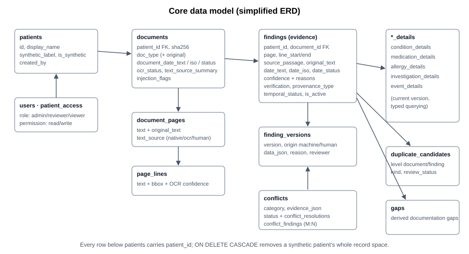

# MedTrace Data Model

The schema lives in [`backend/medtrace/schema.sql`](../backend/medtrace/schema.sql). Design principles:

- **Stable text identifiers** with type prefixes (`pat_`, `doc_`, `fnd_`, `cfl_`, …).
- **Patient-scoped rows**: every clinical table carries `patient_id`; foreign keys use `ON DELETE CASCADE` so deleting a synthetic patient removes the whole record space.
- **Append-only evidence**: machine extraction (version 1) and the verbatim passage are never modified; corrections add versions.
- **Derived data is recomputable**: gaps, duplicates and conflicts can be re-detected at any time; reviewer decisions on them are preserved.

## Patients and access
| Table | Key columns |
|---|---|
| `patients` | `id`, `display_name`, `synthetic_label`, `date_of_birth_text`, `sex`, `is_synthetic`, `created_by` |
| `users` | `username`, `password_hash` (scrypt), `role` (admin/reviewer/viewer), lockout counters |
| `sessions` | `token_hash` (SHA-256 of the cookie token), `user_id`, `expires_at` |
| `patient_access` | (`user_id`, `patient_id`) → `permission` read/write |

## Documents
| Table | Key columns |
|---|---|
| `documents` | `patient_id`, `original_filename` (sanitised, display only), `stored_filename` (server generated), `file_format`, `sha256`, `doc_type`, `doc_type_confidence`, `doc_type_source` (classifier/human), `doc_type_original`, `document_date_text` / `_iso` / `_status`, `provider`, `page_count`, `upload_date`, `extraction_status`, `ocr_status`, `text_source_summary`, `ocr_mean_confidence`, `injection_flags`, `error_message` |
| `document_pages` | `text` (current) + `original_text` (machine, immutable), `text_source` + `original_text_source` (native/ocr/human_corrected), `ocr_confidence`, page size |
| `page_lines` | one row per text line: `text`, bounding box `x0,y0,x1,y1`, OCR `confidence`, `source` |
| `page_text_corrections` | previous and corrected text, reason, reviewer, time |
| `processing_runs` | extractor version, start/finish, duration, per-stage timings (`stages_json`) |

## Findings and evidence
`findings` is the evidence record for one extracted fact:

| Group | Columns |
|---|---|
| Identity | `id`, `patient_id`, `document_id`, `run_id`, `finding_type` (condition/medication/allergy/investigation/event), `section` |
| Evidence | `page_number`, `line_start`, `line_end`, `source_passage` (verbatim line), `original_text` (verbatim span) |
| Provenance | `extraction_method` (rules_native_text / rules_ocr_text / rules_human_corrected_text), `provenance_type` (direct_extraction / ocr_extraction / human_correction) |
| Confidence | `confidence_score`, `confidence_label`, `confidence_reasons` |
| Verification | `verification_status` (unverified / human_verified / corrected / rejected), `current_version` |
| Time | `date_text` (as written), `date_iso` (only when justified), `date_precision`, `date_status` (parsed / partial / ambiguous / missing / document_date / unparsed), `date_candidates`, `date_role`, `temporal_status` |
| Lifecycle | `is_active` (0 when superseded by re-extraction), `created_at` |

`finding_versions` holds every version: `version`, `origin` (machine/human), `data_json`, `date_text`, `date_iso`, `reason`, `created_by`, `created_at`.

### Typed details (current version)
| Table | Columns |
|---|---|
| `condition_details` | `name_as_written`, `normalized_name`, `status_as_documented`, `classification` |
| `medication_details` | `name_as_written`, `normalized_name`, `strength`, `dosage`, `route`, `frequency`, `duration`, `start_date_text`, `stop_date_text`, `status` |
| `allergy_details` | `substance`, `normalized_substance`, `reaction`, `severity`, `assertion` |
| `investigation_details` | `test_name`, `normalized_test`, `category`, `value_text`, `value_numeric`, `unit`, `reference_range`, `flag_as_written`, `converted_value`, `converted_unit`, `conversion_rule` |
| `event_details` | `event_type`, `description` |

Medication statuses: `prescribed`, `documented_ongoing`, `documented_stopped`, `documented_changed`, `historical`, `uncertain`, `mentioned_only`, `unknown`.
Allergy assertions: `documented_allergy`, `explicitly_denied_specific`, `explicitly_denied_general`, `status_not_recorded` (absence of any statement is shown per document as *not documented* and is not stored as a finding).

## Analysis tables
| Table | Purpose |
|---|---|
| `conflicts` | `conflict_key` (deterministic), `category`, `explanation`, `evidence_json` (document, page, passage, date and value from each source), `status`, `still_detected`, `detector_version` |
| `conflict_findings` | M:N link conflict ↔ finding |
| `conflict_resolutions` | status transitions with note, reviewer and time |
| `duplicate_candidates` | `level` (document/finding), `item_a`, `item_b`, `kind`, `similarity`, `details_json`, `review_status` |
| `gaps` | documentation gaps (derived) |

## QA, evaluation, audit
`qa_logs` (question, status, full answer JSON), `evaluation_runs` (metrics + markdown report), `review_sessions` (timed baseline vs MedTrace sessions, `participant_kind` human / automated_simulation), `access_logs` (timestamp, user ID, action, patient ID, resource ID, outcome — never document text or questions).

## Relationships
patient 1–N documents 1–N pages 1–N lines; document 1–N findings 1–N versions; finding 1–1 typed detail; conflicts N–M findings; duplicate candidates reference two documents or two findings of the same patient.

## Adding documents without destroying history
New uploads only insert rows. Re-processing a document marks earlier *unverified* machine findings `is_active = 0` (kept for audit) and keeps human-reviewed findings. Conflicts that disappear after a correction keep their resolution history with `still_detected = 0`.
