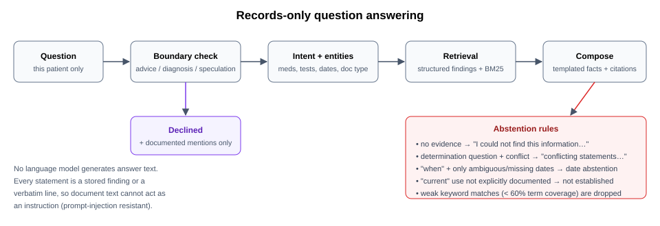

# Records-Only Question Answering

Endpoint: `POST /api/patients/{pid}/ask` (`qa/engine.py`). The question is answered **only** from the selected patient's records; the patient scope comes from the authorised URL, never from the question text.

## Processing steps
1. **Medical boundary check** (before retrieval):
   - treatment/medication advice ("should…", "can she stop…", "recommend", "what treatment should…") → `declined_clinical_advice`;
   - diagnosis or clinical interpretation ("does the patient have…", "is the HbA1c normal?", "what does … mean") → `declined_clinical_judgement`, with only the documented mentions of the terms shown;
   - speculation ("likely", "will … get worse") → `declined_unsupported_inference`;
   - "why" questions → answered only by quoting a verbatim passage that contains a documented reason (*due to*, *because*), otherwise `abstained_not_established`.
2. **Intent and entities** — intents: conflicts, gaps, medication changes, allergies, latest investigation, current medication, medications, events, investigations, conditions, documents, keyword fallback. Entities: medication names (lexicon + names in this patient's findings), tests (lexicon + groups such as *thyroid*, *lipid*, *glucose*), conditions, allergens, explicit dates, and a document-type scope ("in the discharge summary").
3. **Retrieval** — structured retrieval over the patient's current findings; BM25 keyword search over the patient's page lines (fallback and *which documents mention…*); conflict and gap records.
4. **Composition** — each fact is a stored finding rendered by a fixed template with its date wording ("record dated …", "ambiguous") and a citation (document, page, line, verbatim passage). Normalised names and converted values are attached separately and labelled *not verbatim / display-only*.

## Abstention and status values
| Status | When |
|---|---|
| `answered` | evidence found, no relevant conflict |
| `answered_with_conflicts` | a listing question whose evidence includes detected conflicts (both sides shown) |
| `answered_no_conflicts_detected`, `answered_none_documented`, `answered_no_gaps_detected` | the honest "nothing documented/detected" answers, with the note that absence ≠ proof |
| `abstained_no_evidence` | nothing found: "I could not find this information in the uploaded records." |
| `abstained_conflict` | a determination question ("Is the patient allergic to penicillin?") on conflicting evidence: "The records contain conflicting statements. I cannot determine which is correct." |
| `abstained_ambiguous_date` | a *when* question whose only relevant dates are ambiguous |
| `abstained_not_established` | e.g. current medication use not explicitly documented; event mentioned without a date |
| `declined_*` | see boundary check |

Additional safeguards: weak keyword matches (< 60 % of question terms present in the line) are not shown as evidence; uncertainty notes are added when cited facts are unverified, low-confidence or ambiguously dated, or when the same test appears in different units; per-document notes say where no allergy statement exists ("status not documented in this record").

## Why no language model
Answers are built from stored findings and verbatim lines, never generated free text. This makes three guarantees structural rather than behavioural: (1) the system cannot invent a medical fact, (2) document text cannot act as an instruction (prompt injection is inert — and instruction-like lines are additionally flagged and excluded), and (3) every statement has a citation. The cost is coverage: questions phrased outside the intent patterns fall back to keyword passages or abstain. An optional LLM layer could rephrase answers in future, but only over the retrieved, cited facts and with the same abstention rules.

## Displayed to the user
Question, status, answer, conflicts with both sources, uncertainty, documented facts with clickable citations (opening the evidence viewer), verbatim passages, notes, retrieval methods and counts, and the boundary statement. Every question and answer is stored in `qa_logs`; the audit log records only identifiers.

## Medical boundaries
MedTrace retrieves what the records document. It does not diagnose, interpret results, assess severity, recommend medications, doses or treatment, or provide emergency advice.
