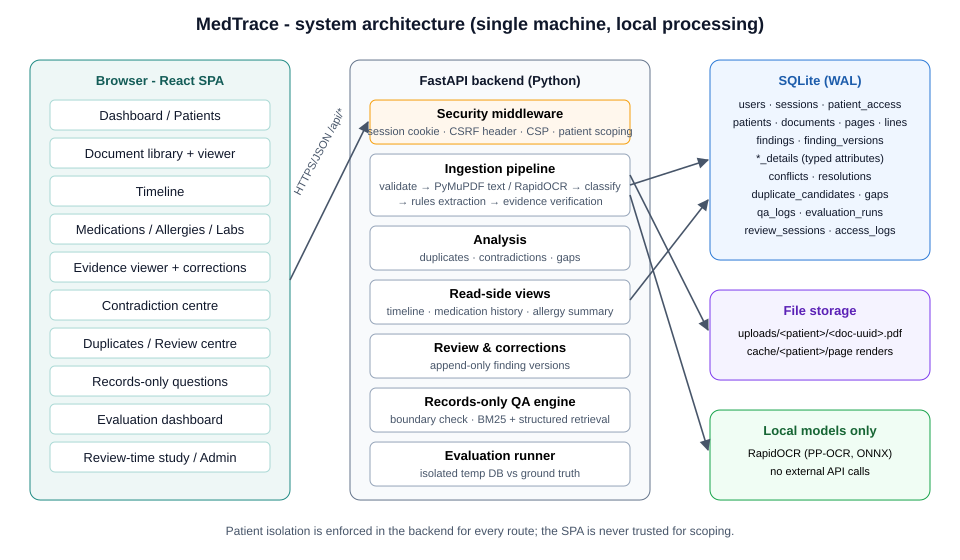
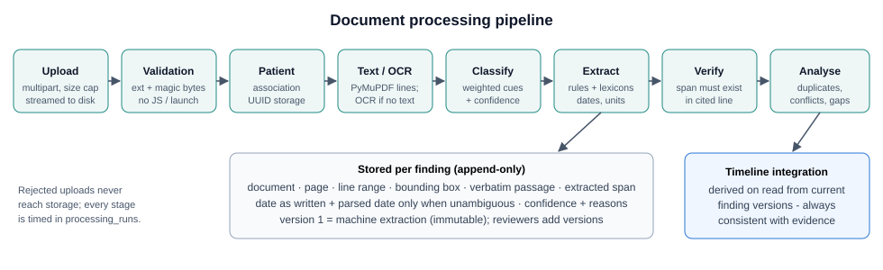
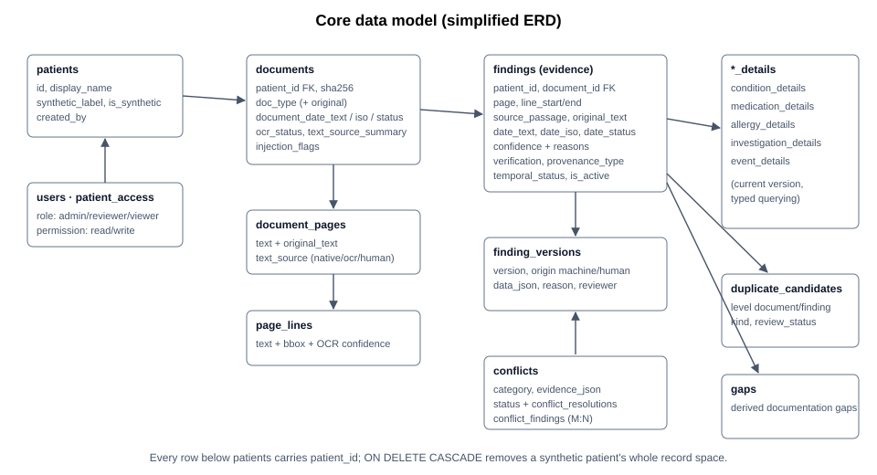
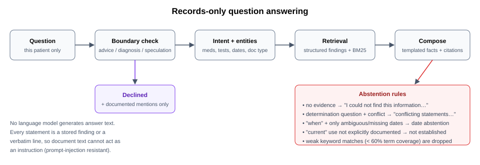
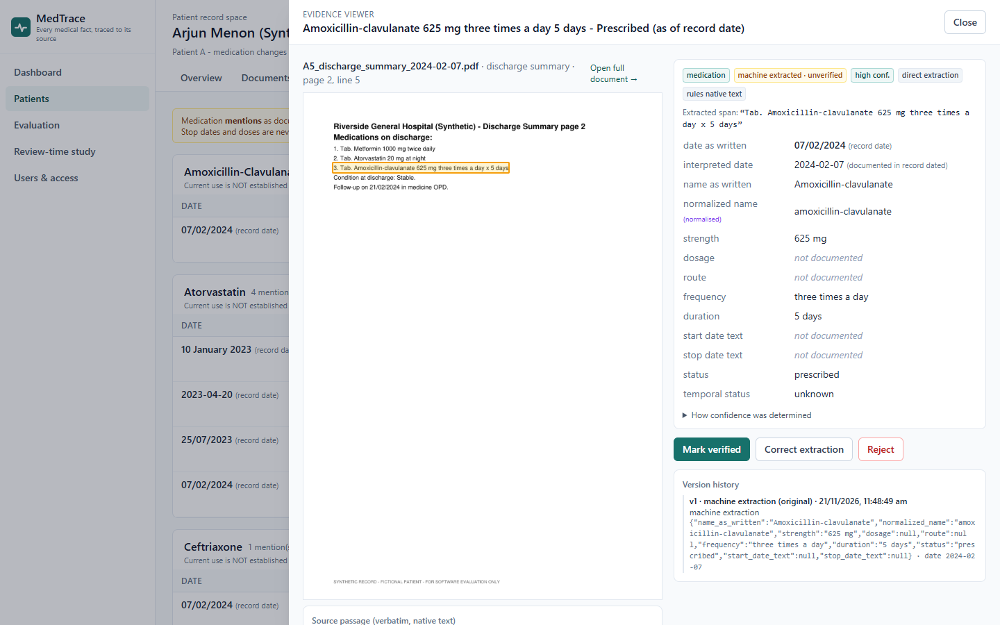
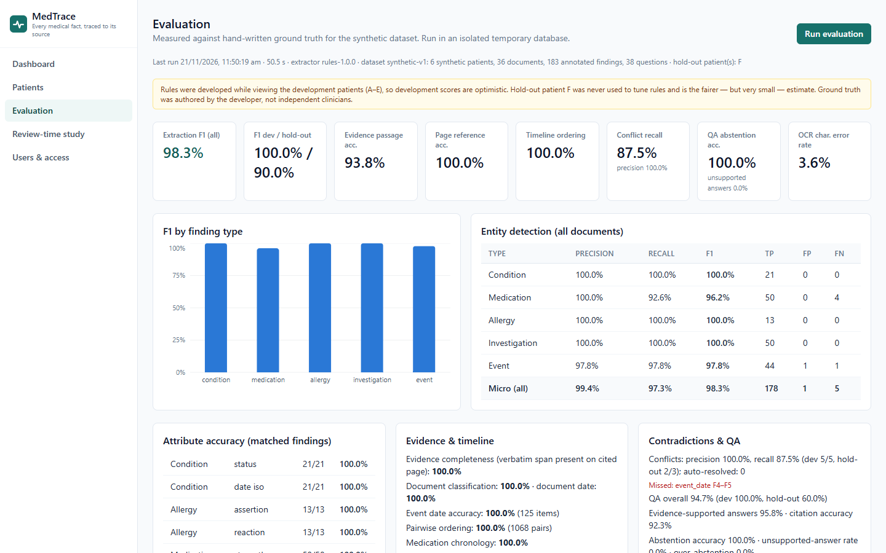

# MedTrace — Technical Documentation

**One Patient, Many Records · Every Medical Fact, Traced to Its Source**

Domain: Data Engineering & Distributed Systems (with applied AI/NLP) · Version 1.0 (extractor `rules-1.0.0`) · November 2026

---

## Abstract
Medical histories are fragmented across prescriptions, laboratory reports, discharge summaries, consultation notes and imaging reports that repeat, contradict and omit one another, use different units and date conventions, and often arrive as scans. MedTrace is a local, evidence-based record-reconstruction system that ingests such documents (native and scanned PDFs, PNG, JPG), extracts conditions, medications, allergies, investigations and events with a deterministic rules engine, links every fact to the exact document, page, line, bounding box and verbatim passage, and reconstructs a chronological history. It flags duplicates, contradictions and documentation gaps instead of silently resolving them, preserves original units and dates (never guessing DD/MM vs MM/DD), supports versioned human correction, and answers records-only questions with citations — abstaining when evidence is missing, conflicting or ambiguous and declining diagnosis or treatment questions. On a 36-document synthetic dataset with hand-written ground truth, MedTrace reaches extraction F1 0.983 overall and 0.900 on a hold-out patient never used for tuning, 100 % page-reference accuracy, 100 % abstention accuracy on 14 questions requiring abstention or refusal, and zero cross-patient citations. MedTrace does not diagnose or advise and claims no regulatory compliance.

## 1. Introduction
Clinicians, patients and care coordinators frequently need to answer simple factual questions — *which medications have been documented, when did the dose change, which allergy statements exist, when was the last HbA1c* — from a pile of documents. Answering them by reading every document is slow and error-prone; answering them with a generic AI summary is fast but unsafe, because summaries lose dates, merge statuses, hide contradictions and invent facts. MedTrace treats the problem as a **data engineering problem with provenance**: extract, normalise only where safe, keep the original, order in time, expose conflicts and gaps, and make every displayed fact verifiable.

## 2. Problem statement
Documents may contain repeated information, contradictions, different units and date formats, medication changes, historical information that looks current, omissions, OCR errors and ambiguity. AI summaries commonly lose dates, merge medication status, resolve contradictions silently, omit dosages, treat missing information as negative and generate unsupported conclusions. The goal is a system that solves organisation, extraction, chronology, provenance and verification **without** acting as a clinician.

## 3. Existing systems and their limitations
| Approach | Limitation addressed by MedTrace |
|---|---|
| Folder of PDFs / document management | no structure, no chronology, no cross-document view |
| EHR problem/medication lists | assume structured input; rarely ingest external scanned documents; provenance to page/line is uncommon |
| Generic OCR + search | finds words, not facts; no statuses, units or conflicts |
| LLM summarisation / chat over PDFs | may hallucinate, drop dates/units, merge time periods, follow instructions embedded in documents; citations are often approximate |
| Clinical NLP toolkits | powerful entity recognition but no end-to-end provenance, review workflow, conflict centre or abstaining QA |

## 4. Proposed solution
A local pipeline — validation, text layer or OCR, classification, rules-based extraction, evidence verification, duplicate/conflict/gap detection — feeding an append-only evidence store, a read-side reconstruction (timeline, medication history, allergy summary) and a deterministic, citing question interface, with a human review workflow and a measurable evaluation framework.

## 5. Objectives
1. Accept PDF, scanned PDF, JPG, JPEG and PNG documents; 2. extract relevant medical facts; 3. preserve source evidence; 4. organise chronologically; 5. track medication mentions, changes and stops; 6. track conditions, allergies, investigations and events; 7. identify duplicates; 8. flag contradictions; 9. detect missing or uncertain information; 10. preserve original units, dates and dosages; 11. allow corrections while retaining evidence; 12–14. answer records-only questions with exact citations and abstain when evidence is insufficient; 15. isolate patients; 16. update the history when new documents arrive; 17. measure extraction accuracy and reviewer efficiency.

## 6. Scope
**In scope:** synthetic patients; English documents; the five document types above; local single-machine deployment; rules-based extraction; reviewer workflow; evaluation. **Out of scope:** diagnosis, interpretation, treatment or medication recommendations, emergency advice, handwriting recognition, HL7/FHIR integration, multi-tenant cloud deployment, regulatory certification.

## 7. Functional requirements
| ID | Requirement | Implementation |
|---|---|---|
| FR1 | Upload and validate documents | `POST /documents`, `ingest/validation.py` |
| FR2 | Text extraction + OCR when needed | `ingest/text_extraction.py` |
| FR3 | Classify document type | `ingest/classify.py`, reviewer override |
| FR4 | Extract conditions, medications, allergies, investigations, events | `extract/extractor.py` |
| FR5 | Evidence for every finding | `findings` evidence columns, `page_lines` boxes |
| FR6 | Chronological timeline with filters | `views.timeline`, `GET /timeline` |
| FR7 | Medication history and documented changes | `views.medication_history` |
| FR8 | Duplicates, contradictions, gaps | `analysis/*` |
| FR9 | Human verification and correction with history | `corrections.py`, `finding_versions` |
| FR10 | Records-only question answering with abstention | `qa/engine.py` |
| FR11 | Patient management, isolation and access control | `security.py`, `patient_access` |
| FR12 | Evaluation metrics and dashboard | `evaluation/runner.py`, Evaluation page |

## 8. Non-functional requirements
- **Traceability:** 100 % of stored findings have a verbatim span verified against the cited line (measured evidence completeness 1.000).
- **Safety:** no generated free text; no auto-resolution; explicit abstention and refusal.
- **Privacy:** local processing, no external calls, identifier-only audit log.
- **Security:** authentication, CSRF protection, backend patient scoping, upload hardening.
- **Performance:** native PDFs ~0.14 s median, OCR documents ~5.8 s median on a laptop CPU.
- **Reproducibility:** deterministic dataset generation, deterministic extraction, one-command evaluation.
- **Maintainability:** modules by responsibility, 77 automated tests.

## 9. System architecture

The browser SPA talks JSON to FastAPI on the same origin. Security middleware enforces CSRF and headers; routes enforce authentication and patient scope. The ingestion pipeline writes documents, pages, lines and findings to SQLite and originals to a UUID-named file store. Analysis and read-side views derive duplicates, conflicts, gaps, timeline and medication history. The QA engine retrieves only from the authorised patient's data. The evaluation runner seeds an isolated temporary database and compares output with ground truth. Module-level detail: [ARCHITECTURE.md](ARCHITECTURE.md).

## 10. Document ingestion

Uploads are streamed with a size cap, validated (extension allow-list, magic bytes, PDF parsing and page limit, active-content rejection, image decoding with a pixel limit), stored as `uploads/<patient>/<uuid>.<ext>` with a SHA-256 hash, and processed in a background task. Each stage is timed in `processing_runs.stages_json`. Metadata stored per document: ID, patient ID, type (+ classifier original and confidence), original filename (sanitised, display-only), upload date, document date (text, ISO when unambiguous, status), provider, format, page count, extraction status, OCR status, text-source summary, OCR mean confidence, SHA-256, instruction-like text flags.

## 11. OCR
OCR runs **only** when a PDF page has fewer than 25 characters of text or the upload is an image. Engine: **RapidOCR** with PP-OCR detection/classification/recognition models on ONNX Runtime, fully local; Tesseract is not required. Pages are rendered at 200 dpi; recognised fragments on the same row are merged into lines with bounding boxes and mean confidence. Text sources are tracked per page and line as `native`, `ocr` or `human_corrected`; the machine text is kept in `original_text`. Measured on the 7 OCR documents: mean character error rate 3.6 %, mean engine confidence 0.991; typical errors are merged words ("CONSULTATIONNOTE") and misread capitals ("lodinated" for "Iodinated"), handled by space-free classifier cues and an OCR-only fuzzy lexicon lookup that lowers confidence and states why.

## 12. Document classification
Weighted regular-expression cues per type (e.g. *discharge summary*, *date of admission*, *hospital course* for discharge summaries; *reference range*, *sample collected* for lab reports), doubled when found in the first six lines. Score margin gives a confidence; below a minimum score the document is `unclassified`. Measured accuracy: 36/36 after adding OCR-robust cues (35/36 before). Reviewers can override; the classifier's output is retained.

## 13. Structured extraction
Documents are split into sections by headings; any other `Label:` line closes a section. Rules per type extract only what is written:
- **Conditions** with documented status (*confirmed as documented, suspected, possible, ruled out, history of, known case, explicitly denied*); never inferred from results.
- **Medications**: name as written + normalised generic, strength, dosage, route, frequency, duration, start/stop dates, and one of eight documented statuses. Attributes that are not written are `null` and shown as *not documented*.
- **Allergies**: documented allergy (substance, reaction, severity), explicit specific negative, explicit general negative, explicit "status not recorded".
- **Investigations**: test as written + normalised, verbatim value, unit, reference range and printed flag; imaging impressions as result text.
- **Events**: admission, discharge, surgery, procedure, consultation, investigation, follow-up (relative intervals stay text).
Instruction-like lines are flagged and skipped. Full rules: [EXTRACTION_AND_PROVENANCE.md](EXTRACTION_AND_PROVENANCE.md).

## 14. Medical data schema

Central table `findings` (evidence, provenance, confidence, verification, time) with typed `*_details` tables for the current version and append-only `finding_versions`. Full description: [DATA_MODEL.md](DATA_MODEL.md).

## 15. Medication tracking
Mentions are grouped per normalised medication and ordered by date. Status → temporal status mapping keeps "prescribed" and "mentioned only" as **unknown** current use; only explicit continuation wording yields "current as documented", and only as of that record's date. Explicit change/stop statements and between-record strength differences are listed separately. Stop dates are recorded only if written (e.g. "stopped on 04/02/2024" with a declared DD/MM/YYYY convention).

## 16. Allergy handling
Three distinctions are kept everywhere — in data, UI and answers: **explicitly documented allergy**, **explicitly documented negative** (general or substance-specific), and **not documented** (per document; never stored as a negative). A document that explicitly says "allergy status: not recorded" is a fourth, explicit state. Positive vs negative statements across documents become allergy conflicts.

## 17. Investigation handling
Values are stored verbatim (`value_text`) with a numeric copy when parseable; unit and reference range verbatim; printed flags (H/L) only if printed. The UI marks tests documented in more than one unit. MedTrace never classifies a result as normal/abnormal.

## 18. Unit preservation
Conversions exist only as explicit rules (glucose, creatinine, haemoglobin, cholesterol, triglycerides, HbA1c), stored in separate `converted_*` fields with the rule text, displayed as *display only*, unit-tested, and never used to overwrite or compare evidence. Same-day values in different units are not compared; a `unit_difference` gap is raised instead.

## 19. Date handling
Original text is always stored. ISO and textual-month dates parse directly; numeric dates are resolved only by impossibility (day > 12) or by a convention the document itself declares; otherwise they are **ambiguous** with both candidates stored and no ISO value. Partial dates keep month/year precision; two-digit years are not expanded. Each finding records a date role (specimen date, stop date, admission date, document date fallback, …). Event dates are preferred; document dates are a labelled fallback; upload dates are never used.

## 20. Chronological reconstruction
The timeline is derived on read from current finding versions, so corrections and new documents are reflected immediately. Dated entries are sorted by (date, document, page, line); partial dates sort at the start of their period with a *partial* label; undated and ambiguous entries are listed separately without inferred positions. Filters: type, date range, document, verification status and text. Measured: event-date accuracy 1.000 and pairwise ordering accuracy 1.000 (1,068 pairs).

## 21. Duplicate detection
Exact (hash), near-duplicate (≥ 0.90 similarity using the maximum of 3-shingle Jaccard and whitespace-free character similarity, plus compatible document dates), similar-but-distinct (same type, ≥ 0.60), and finding-level duplicate/related candidates. A review interface records decisions; nothing is merged. Measured: precision 1.000, recall 1.000, false-positive rate 0.000; the OCR-tolerant character similarity was required to detect the scanned copy (D5/D6), which the shingle measure alone classified as merely similar.

## 22. Contradiction detection
Same-day medication dose or status conflicts, allergy positive-vs-negative conflicts, event-date conflicts for the same procedure or nearby admissions/discharges, same-day lab value conflicts in the same unit. Each conflict stores the evidence from every source, an explanation and a status; only humans change status, with mandatory explanations for resolutions and a full history. Measured: precision 1.000, recall 0.875 (the miss is on the hold-out set), negative control not flagged, zero automatic resolutions. Details: [TIMELINE_AND_CONTRADICTIONS.md](TIMELINE_AND_CONTRADICTIONS.md).

## 23. Missing information
Gaps are generated per document and finding: missing document date, ambiguous dates, missing dose/frequency/date, uncertain medication status, missing allergy reaction, no allergy statement, explicit "not recorded", missing reference range, missing event date, unit differences, low OCR confidence, instruction-like text. Each gap is worded as a statement about documentation (e.g. "This is NOT evidence of no allergies").

## 24. Provenance
Each finding records extraction method (rules on native / OCR / human-corrected text) and provenance type (direct extraction, OCR extraction, human correction). Normalisation and derived metadata are stored separately and labelled. Machine version 1 is immutable.

## 25. Evidence verification
A finding is persisted only if its verbatim span occurs in the cited source line. The evidence viewer renders the original page, highlights the bounding box, shows ±2 context lines, the extracted span, all fields (with *not documented* for nulls), the confidence explanation, related conflicts and gaps, and the version history.

## 26. Human corrections
Verify, correct (reason required; type-specific editable fields; enum validation; ISO date validation), or reject (reason required) a finding; correct page text (original kept; reprocess extracts from the corrected text, keeping human-reviewed findings); correct the document type. Each action appends a version with reviewer and timestamp, triggers re-detection of duplicates/conflicts/gaps, and is visible in the review centre.

## 27. Records-only question answering
Boundary check → intent and entity detection → structured + BM25 retrieval over the patient's records → templated facts with citations → abstention rules. No language model generates text. Full description: [RECORDS_QA.md](RECORDS_QA.md).

## 28. Retrieval architecture

Structured retrieval queries the current findings (type, normalised entity, date scope, document-type scope). Keyword retrieval is BM25 (k1 = 1.2, b = 0.75) over the patient's page lines, built per question (the per-patient corpus is small), with a 60 % query-term coverage threshold before a passage is shown as evidence. Retrieval never crosses the authorised patient boundary.

## 29. Abstention
The engine abstains when no evidence exists, when a determination question meets conflicting evidence, when a *when* question has only ambiguous or missing dates, and when current use is not explicitly documented; it declines diagnosis, clinical interpretation, treatment/medication advice and speculation. Measured on 14 questions requiring abstention or refusal: abstention accuracy 1.000, unsupported-answer rate 0.000.

## 30. Database design
SQLite with WAL, foreign keys, cascading patient deletion, indexes on patient/type, document, normalised medication and test names, and unique constraints for deterministic conflict keys and duplicate pairs. The design supports adding documents without destroying history (insert-only; superseded machine findings kept inactive).

## 31. API design
REST under `/api`, patient-scoped resources under `/api/patients/{pid}/…`, JSON bodies validated by Pydantic, consistent error codes (404 for invisible resources), OpenAPI at `/docs`. Endpoints: [API_DOCUMENTATION.md](API_DOCUMENTATION.md).

## 32. Security
scrypt password hashes, HttpOnly SameSite=Strict session cookie with server-side hashed tokens, login lockout, CSRF header, CORS allow-list, CSP and security headers, upload hardening, path-traversal defence, environment-based configuration with no hardcoded credentials, identifier-only audit log, and prompt-injection-inert QA. Details and limitations: [SECURITY_AND_PRIVACY.md](SECURITY_AND_PRIVACY.md).

## 33. Patient isolation
Isolation is enforced in the backend: every patient route checks `require_patient` (admin, or explicit grant; viewers read-only), every query filters by `patient_id`, and object lookups include the patient ID. Invisible patients and objects return 404. Tests verify reviewer isolation, cross-patient URLs and IDs, QA isolation and file/page access. Measured cross-patient citation rate in QA: 0.

## 34. Implementation
| Layer | Size / notes |
|---|---|
| Backend | ~5,600 lines (Python + SQL schema) in 32 files, including package `__init__` files |
| Frontend | ~1,900 lines of React/TypeScript in 25 files |
| Dataset | 36 documents, 183 annotated findings, 38 questions |
| Tests | 77 Pytest tests |
Key decisions: deterministic rules instead of an LLM (verifiability, no paid API, injection resistance); RapidOCR instead of Tesseract (pip-installable, no system binary, strong accuracy on clean scans); derived-on-read timeline (no drift); append-only versions (auditability).

## 35. Testing
77 tests across dates/units, extraction, ingestion/OCR, API security and isolation, timeline/duplicates/contradictions/gaps, corrections and QA, and evaluation arithmetic plus an end-to-end evaluation run. All pass. Details: [TESTING_AND_EVALUATION.md](TESTING_AND_EVALUATION.md).

## 36. Evaluation
Hand-written ground truth for 36 synthetic documents (development patients A–E, hold-out patient F). Metrics: entity P/R/F1, field accuracy, evidence accuracy, timeline accuracy, duplicate and contradiction P/R, QA accuracy/abstention/unsupported-answer rate, OCR CER, latency, and a labelled review-time estimate. A pre-tuning baseline is kept for comparison.

## 37. Results
| Metric | Value |
|---|---|
| Extraction F1 — all / development / hold-out | **0.983** / 1.000 / **0.900** (pre-tuning: 0.964 / 0.984 / 0.871) |
| Extraction precision / recall (all) | 0.994 / 0.973 |
| Page reference / passage / completeness | 1.000 / 0.938 / 1.000 |
| Event date accuracy / ordering accuracy | 1.000 / 1.000 |
| No fabricated dates (undated/ambiguous items) | 40 / 40 |
| Duplicate precision / recall / FP rate | 1.000 / 1.000 / 0.000 |
| Contradiction precision / recall | 1.000 / 0.875 |
| QA overall / development / hold-out | 0.947 / 1.000 / 0.600 |
| QA abstention accuracy / unsupported-answer rate | 1.000 / 0.000 (pre-tuning: 0.643 / 0.357) |
| OCR mean CER | 0.036 |
| Median processing time native / OCR | 138 ms / 5.8 s |
| Review time | automated estimate only: −36 % (916.8 s → 589.8 s); no human study performed |

Interpretation: development scores are optimistic because the rules were refined on those documents. The hold-out patient exposes the real limitation of a rules approach: unseen vocabulary (*propranolol*) and phrasing ("after appendicectomy on 29 June") are missed, and downstream components (conflicts, QA) inherit the miss. Importantly, the failures are *omissions*, not fabrications: precision stays high and no unsupported answer was produced.

## 38. Limitations
- Rules and small lexicons; English only; limited layouts; no handwriting.
- Synthetic, author-annotated, small dataset; development metrics optimistic; small hold-out.
- OCR evaluated on clean synthetic scans; real photos will be worse.
- Contradiction categories are limited; absence of a detected conflict is not proof of consistency.
- Single-node MVP: in-process background tasks, SQLite, no TLS termination, no encryption at rest, no MFA.
- No human review-time study has been run.
- No regulatory compliance is claimed.

## 39. Future scope
Learned extraction (clinical NER/relation models or a local LLM) gated by the same evidence-verification step; larger lexicons and RxNorm/LOINC/SNOMED mapping where licences allow; FHIR export; multilingual OCR and extraction; handwriting; job queue + workers and PostgreSQL for multi-user deployment; encryption at rest and TLS by default; richer conflict rules (cross-date status inconsistencies, dose-unit normalisation); a real reviewer study using the built-in timing tool; independent clinical annotation of a larger, realistic (de-identified, approved) corpus.

## 40. Conclusion
MedTrace shows that fragmented records can be made understandable without making software a medical authority: every displayed fact is traceable to a page and passage, uncertainty and contradictions stay visible, corrections never erase evidence, and questions are answered only when the records support them. The measured results on synthetic data are strong where the rules apply and degrade by omission — not invention — where they do not, which is the failure mode a provenance-first system should have.

## 41. References actually used
- FastAPI documentation — https://fastapi.tiangolo.com/
- PyMuPDF documentation — https://pymupdf.readthedocs.io/
- RapidOCR project — https://github.com/RapidAI/RapidOCR ; PaddleOCR PP-OCR models — https://github.com/PaddlePaddle/PaddleOCR
- ONNX Runtime — https://onnxruntime.ai/
- SQLite documentation (WAL, foreign keys) — https://www.sqlite.org/docs.html
- Python `hashlib.scrypt` — https://docs.python.org/3/library/hashlib.html
- Robertson, S., Zaragoza, H. *The Probabilistic Relevance Framework: BM25 and Beyond*. Foundations and Trends in IR, 2009 (BM25 scoring used in keyword retrieval).
- OWASP Cheat Sheet Series (session management, CSRF, file upload) — https://cheatsheetseries.owasp.org/
- IFCC/NGSP HbA1c master equation (mmol/mol = (% − 2.15) × 10.929) and standard SI conversion factors for glucose (18.016), creatinine (88.42), cholesterol (38.67), triglycerides (88.57).
- React, Vite, Tailwind CSS and Recharts documentation.
